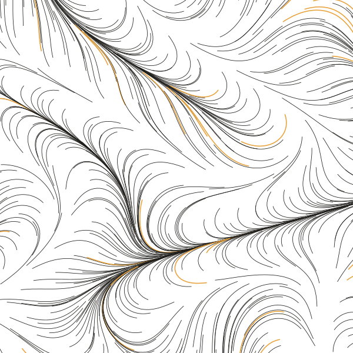
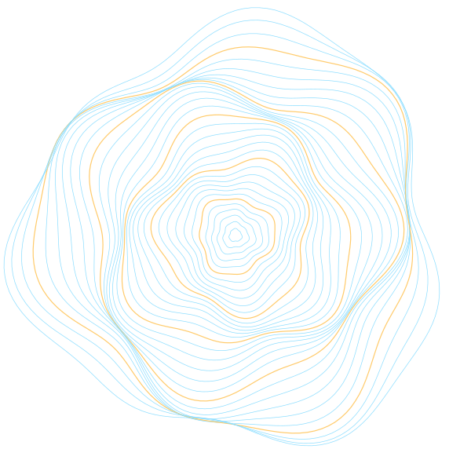
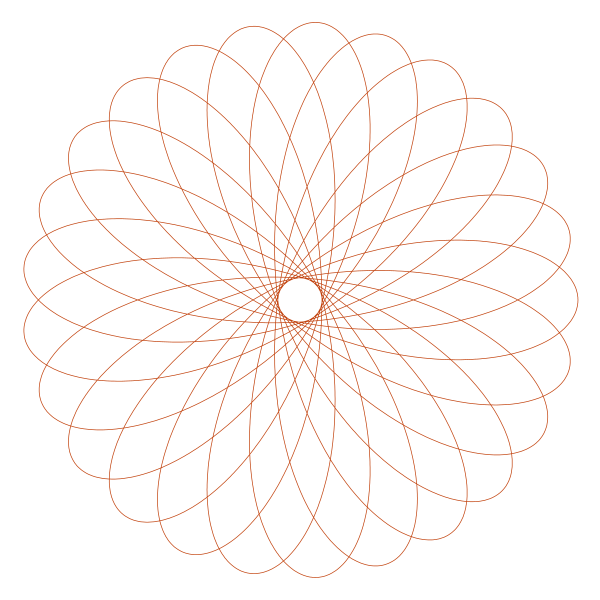
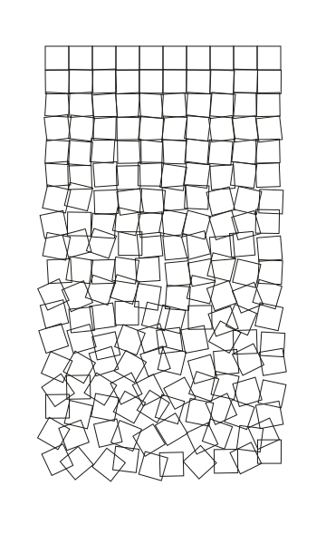
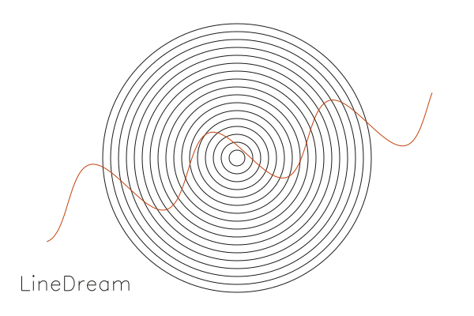

<h1 align="center">LineDream</h1>

<p align="center">
  <strong>Generative art for Python, built for pen plotters.</strong><br>
  Object-oriented sketches that render to clean, layered SVG.
</p>

<p align="center">
  <a href="https://pypi.org/project/LineDream/"></a>
  <a href="https://pypi.org/project/LineDream/"></a>
  <a href="https://github.com/marcrleonard/LineDream/actions/workflows/tests.yml"></a>
  <a href="pyproject.toml"></a>
  <a href="https://linedream.marcrleonard.com/playground/"></a>
</p>

<p align="center">
  
  
  
  
</p>

<p align="center">
  <a href="https://linedream.marcrleonard.com">Website</a> ·
  <a href="https://linedream.marcrleonard.com/playground/">Playground</a> ·
  <a href="https://linedream.marcrleonard.com/documentation/">Documentation</a> ·
  <a href="https://pypi.org/project/LineDream/">PyPI</a>
</p>

---

LineDream is heavily influenced by [p5.js](https://p5js.org) and [Processing](https://processing.org), but takes a
more object-oriented approach: every shape owns its own style and transformations, so there is very little global
state. Output is SVG, with groups written as Inkscape layers so a sketch goes straight to an AxiDraw or any other pen
plotter. There is no draw loop; a sketch renders a single frame, and a plain Python loop is enough to make a series.

## Try it in your browser

The **[playground](https://linedream.marcrleonard.com/playground/)** runs LineDream entirely client-side with
[Pyodide](https://pyodide.org): edit a sketch, hit run, download the SVG. Nothing to install.

## Install

```bash
pip install LineDream
# or
uv add LineDream
```

Python 3.9 to 3.14, on Linux, macOS and Windows.

## Quickstart

```python
import math
from LineDream import Canvas, Circle, Group, Line, Text

Canvas.width = 600
Canvas.height = 400
Canvas.background_color = "#F4EEE1"

# Concentric rings in their own (Inkscape/AxiDraw) layer
rings = Group(label="rings")
for r in range(10, 180, 10):
    rings.add_item(Circle(300, 200, r, stroke_color="#1C1B18"))

# One continuous sine stroke, rotated about its center
wave = Line([(x, 200 + 40 * math.sin(x / 25)) for x in range(40, 561)], stroke_color="#C2410C")
wave.rotate(-15)

Text("LineDream", 24, 360, font_size=28, stroke_color="#1C1B18")

Canvas.save("hello.svg")
```

<p align="center"></p>

`Canvas.save("hello.svg", open_viewer=True)` opens the result as soon as it is written, and
`Canvas.save("", as_string=True)` returns the SVG instead of writing a file.

## What's in the box

| | |
|---|---|
| **Primitives** | `Line`, `Point`, `Circle`, `Ellipse`, `Arc`, `Rectangle`, `Square` |
| **Text** | `Text`: single-stroke [Hershey](https://en.wikipedia.org/wiki/Hershey_fonts) fonts (32 bundled), wrapped and aligned, so lettering plots as one pen line |
| **Grouping** | `Group(label=...)` becomes an Inkscape layer, which AxiDraw and similar tools plot pen by pen |
| **Styling** | `stroke_color`, `stroke_width`, `fill_color`, `fill_opacity`, as keyword arguments or attributes on any shape |
| **Transforms** | `transform(x, y)`, `rotate(degrees)`, `rotate_x/y/z`, `scale(amt)`, applied per shape |
| **Canvas** | `width`, `height`, `units` (e.g. `"mm"` for plotter-ready sizes), `background_color` |
| **Helpers** | `CircleMath` for polar/cartesian conversions; `Line.from_array` for NumPy (N, 2) or (N, 3) arrays |

### Custom shapes

Subclass `BaseShape`, add vertices, and the new shape gets styling, transforms and SVG output for free:

```python
import math
from LineDream import BaseShape, Canvas

class Hexagon(BaseShape):
    def __init__(self, cx, cy, radius, **kwargs):
        super().__init__(**kwargs)
        self.close_path = True
        for i in range(6):
            angle = i * math.pi / 3
            self.add_vertex(cx + radius * math.cos(angle), cy + radius * math.sin(angle))

Canvas.width, Canvas.height = 356, 276
Canvas.units = "mm"

Hexagon(Canvas.width / 2, Canvas.height / 2, 50).rotate(15)
Canvas.save("hexagon.svg")
```

More sketches, with their source, live in the [gallery](https://linedream.marcrleonard.com) and in
[`docs/source/gallery`](docs/source/gallery).

## Using LineDream in your own web page

LineDream is pure Python, so it installs into Pyodide with micropip:

```js
const pyodide = await loadPyodide();
await pyodide.loadPackage(["numpy", "pillow", "lxml", "micropip"]);  // CORE_PACKAGES in browser/packages.mjs
await pyodide.runPythonAsync(`
import micropip
await micropip.install("linedream")
`);
```

This needs 0.4.0 or later; earlier releases depend on vpype, which does not run under Pyodide.
`Canvas.save(open_viewer=True)` is unavailable there, so use `as_string=True` and hand the SVG to the page.

---

## Development

LineDream uses [uv](https://docs.astral.sh/uv/).

```bash
git clone https://github.com/marcrleonard/LineDream.git
cd LineDream
uv sync            # .venv with LineDream (editable) and the dev tools, as pinned in uv.lock
```

### Tests

```bash
uv run pytest
uv run --python 3.9 pytest                          # any supported version; uv fetches it if needed
uv run coverage run -m pytest && uv run coverage html
```

CI ([`tests.yml`](.github/workflows/tests.yml)) runs on every pull request: the suite on Python 3.9 to 3.14 on Linux
plus macOS and Windows, a smoke test of the built wheel, and the suite again under Pyodide in Node.

### Pyodide and the playground

numpy, pillow and lxml come from the Pyodide distribution and drawsvg from PyPI; the `drawsvg[all]` extras (only
used by `open_viewer=True`) are skipped on emscripten.

```bash
uv build --wheel
cd browser && npm install && npm test      # LINEDREAM_TERRAIN=1 also loads scipy and scikit-image

# Local playground: serve the repo root, then open
# http://localhost:8000/browser/?wheel=../dist/linedream-<version>-py3-none-any.whl
python -m http.server
```

The website build copies the playground to `/playground/` along with a wheel built from the same checkout.

### Docs site

```bash
uv run --extra docs python docs/build_website.py   # output in public/
```

### Releasing

```bash
uv build      # sdist and wheel into dist/
```

Releases are published by `.github/workflows/release.yml` when a `v*` tag is pushed, using PyPI trusted publishing
(no token). To cut one:

1. Set the version in `pyproject.toml` and `LineDream/__version__.py`, run `uv lock`, and move the `CHANGELOG.md`
   entry out of "unreleased".
2. Merge to master, then `git tag v0.4.0 && git push origin v0.4.0`.

The workflow checks the tag matches both versions, builds, publishes to PyPI and creates a GitHub release with the
changelog section as its notes. `uv publish` still works for a manual upload.

All package metadata and dependencies live in [`pyproject.toml`](pyproject.toml).

## License

MIT. The bundled Hershey font data and text layout are vendored from [vpype](https://github.com/abey79/vpype), which
adapted them from [fogleman/axi](https://github.com/fogleman/axi); see [`LineDream/fonts/LICENSE`](LineDream/fonts/LICENSE).
